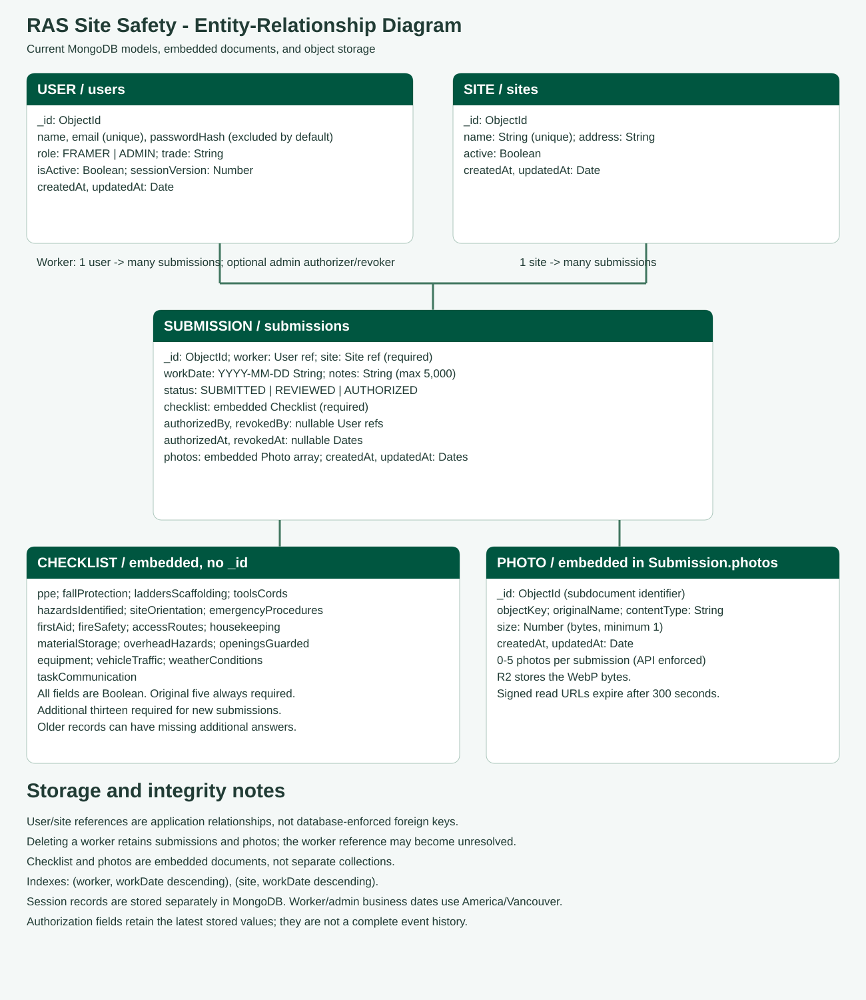

# RAS Safety Authorization

[](https://ras-safety-authorization.netlify.app/)


Built for the Ron Anderson & Sons Junior Software Developer technical assessment.

Framers complete daily safety forms with photos. Administrators review submissions, authorize forms, and manage workers and job sites.

## Demo

- [Live application](https://ras-safety-authorization.netlify.app/)

> Demo hosting: The API runs on Render’s free tier and may sleep when inactive. The first request can take a little longer while it starts up. Please allow a moment for the app to connect.

- [GitHub repository](https://github.com/jtranberg/ras_safety)
- [Entity-Relationship Diagram](docs/RAS_ERD.svg)

### Test Credentials

The demo uses fictional demonstration data.

| Role   | Email              | Password      |
| ------ | ------------------ | ------------- |
| Admin  | admin@example.com  | Adminpassword |
| Framer | framer@example.com | DemoFramer    |

Worker accounts and passwords are explicitly created and set by an administrator in the Admin workspace. The supported setup uses administrator-assigned passwords. An optional legacy seed script remains available for development; it creates demo accounts with SEED_PASSWORD and leaves existing accounts unchanged. To test the Framer workspace, use the Framer credentials above. Administrators can also create additional workers and set their passwords in the Admin workspace.

## Tech Stack

- Frontend: React, TypeScript, Vite, CSS
- Backend: Node.js, Express
- Database: MongoDB, Mongoose
- Authentication: express-session, connect-mongo, bcryptjs
- Photo processing: Multer, Sharp
- Photo storage: Cloudflare R2 using the AWS S3 SDK
- Hosting: Netlify frontend, Render API

## Features

### Framer Workspace

- Sign in with individual credentials. Sign-in requires a valid email address and a password of at least 8 characters, checked in the form and by the API.
- Select an active job site; the work date is automatically set in the America/Vancouver timezone.
- Complete the safety checklist and add notes.
- Attach up to five photos per submission.
- View their own submissions and photos.
- See the safety response leaderboard, with their own rank, points, and streak highlighted.

Worker identity comes from the authenticated account. The backend restricts workers to their own submissions and photo access.

### Admin Workspace

- View submissions across workers and sites.
- Filter by site, worker, and an inclusive work-date range.
- View matching submission totals and authorization counts.
- View submissions per site.
- Open form details and attached photos.
- Authorize forms or revoke authorization.
- Add workers and explicitly set initial passwords.
- Change passwords, revoke access, or delete worker accounts.
- Set or change a password directly within the selected worker's card.
- Prepare an email draft with the worker's login details after successful account creation or password reset.
- Add job sites with an optional address.
- Edit existing job-site names and addresses.

### Safety Response Leaderboard

Gamifies the daily safety form by ranking who responds first. It appears on the Admin dashboard and in the Framer workspace.

- **Daily response order:** each work day, workers are ordered by when they submitted their first form. Only a worker's first form per work day counts, and only if it was submitted on that work day (BC time), so back- or forward-dated forms do not score.
- **Points:** 1st = 5, 2nd = 3, 3rd = 2, and every other response = 1, so consistency counts as well as speed.
- **Rankings:** sorted by points, then first-place finishes, then average position. Workers with identical records share a rank.
- **Per-worker metrics:** points, 1st/2nd/3rd finishes, days responded, participation rate, average position, average and fastest response time, and current and best streak.
- **Team metrics:** days tracked, total responses, average responses per day, average first-response time, and the earliest response of the period.
- **Podium:** the 1st, 2nd, and 3rd responders for the latest day in the period, followed by everyone else in order.
- **Awards:** Early Bird (most first-place finishes), Streak leader (longest current streak), and Most consistent (highest participation).
- **Periods:** Today, Last 7 days, Last 30 days, or All time. On the Admin dashboard, the leaderboard follows the applied site filter.

Times are shown in BC time (America/Vancouver). Participation and streaks count only tracked days, meaning days on which at least one form was submitted. Deleted worker accounts are left out of the leaderboard.

API: `GET /api/submissions/leaderboard?siteId=&from=YYYY-MM-DD&to=YYYY-MM-DD` (any signed-in user; all parameters are optional). It returns `leaderboard`, `metrics`, and `latestDay`. The ranking logic is in `server/src/utils/leaderboard.js`.

### User Experience

- RAS branding and responsive layouts.
- Introductory splash displayed once per browser tab.
- Session restoration after refresh.
- Loading states and success/error messages.
- Show/Hide controls for login, initial worker passwords, and password resets; passwords are masked by default.
- RAS footer with website, phone, email, and Privacy Policy links, with responsive wrapping on mobile.
- Public Privacy Policy available without signing in.
- Cookie notice displayed after the splash screen.
- Cookie notice dismissal remembered in browser storage.

## Local Setup

### Prerequisites

- Node.js 22 or later; hosted deployment currently uses Node.js 24
- npm
- MongoDB
- A Cloudflare R2 bucket with credentials that permit object reads, writes, and deletion

### Backend

From the repository root:

```bash
cd server
npm ci
```

Create `server/.env`:

```env
PORT=3000
NODE_ENV=development
CLIENT_ORIGIN=http://localhost:5173
MONGODB_URI=YOUR_MONGODB_CONNECTION_STRING
SESSION_SECRET=YOUR_RANDOM_SECRET_AT_LEAST_64_CHARACTERS
R2_ENDPOINT=https://YOUR_ACCOUNT_ID.r2.cloudflarestorage.com
R2_ACCESS_KEY_ID=YOUR_R2_ACCESS_KEY_ID
R2_SECRET_ACCESS_KEY=YOUR_R2_SECRET_ACCESS_KEY
R2_BUCKET=YOUR_BUCKET_NAME
```

Generate a session secret with:

```bash
node -e "console.log(require('node:crypto').randomBytes(32).toString('hex'))"
```

Start the API:

```bash
npm run dev
```

The API runs at `http://localhost:3000`.

### Frontend

In a second terminal, from the repository root:

```bash
cd client
npm ci
```

Create `client/.env`:

```env
VITE_API_URL=http://localhost:3000/api
```

Start the frontend:

```bash
npm run dev
```

Open `http://localhost:5173`.

### Remote Dev Preview (e.g. Devin)

When the frontend is opened through a remote preview URL instead of `localhost`, route API calls through the Vite dev server so requests and the session cookie stay same-origin:

```env
# client/.env
VITE_API_URL=/api
VITE_ALLOWED_HOSTS=.preview.devinapps.com
```

Then add the preview origin to the server's comma-separated `CLIENT_ORIGIN` and restart the API:

```env
# server/.env
CLIENT_ORIGIN=http://localhost:5173,https://YOUR-PREVIEW.preview.devinapps.com
```

The Vite proxy forwards `/api` to `http://localhost:3000` (override with `VITE_API_PROXY_TARGET`).

### First Admin Account

For a fresh database, temporarily set `ADMIN_NAME`, `ADMIN_EMAIL`, and `ADMIN_PASSWORD` in `server/.env`, then run from the server directory:

```bash
node src/create-admin.js
```

The script creates an Admin account and leaves existing accounts unchanged. Remove the bootstrap variables afterward.

Sign in as Admin to create workers, explicitly set their passwords, and add fictional job sites.

### Demo Data and Account Setup

The demonstration uses Admin and Framer accounts and fictional job sites. For a fresh local database, follow the First Admin Account steps above.

Worker accounts and passwords are managed through the Admin workspace. Administrators set each worker's initial password when creating the account and can change it afterward. No seed command is required for worker account setup or to test the deployed application.

A fresh database requires an initial Admin account before the admin management features can be used.

### Frontend Build

From `client`:

```bash
npm run build
```

Vite generates the deployment files in `client/dist`.

## Testing

From the `server` directory:

```bash
npm test
```

The 11 automated admin helper tests cover:

- BC work-date boundaries, including daylight saving time.
- Valid filters and rejection of malformed IDs, dates, arrays, and objects.
- Leap years and nonexistent calendar dates.
- CSV escaping, Unicode, and spreadsheet formula handling.
- Complete exported records and UTC authorization/revocation timestamps.
- Photo counts and exclusion of secret metadata.
- Older checklist answers that were not recorded.

The 7 leaderboard tests cover:

- Position points and BC response times across daylight saving changes.
- Daily response order, ignoring repeat forms on the same day.
- Rankings, podium counts, participation, average position, streaks, and team metrics.
- Shared ranks for tied records, with ties decided on exact (unrounded) average position.
- Skipped deleted workers, skipped back- or forward-dated forms, and empty periods.

Latest verified result for this revision: **25 passed, 0 failed** (11 admin helper tests, 7 leaderboard tests, and 7 HTTP regression tests for readiness routing, access boundaries, submission detail responses, leaderboard sign-in, and login input validation).

The helper tests do not exercise the live database, photo uploads, or browser interactions. HTTP regression tests use isolated local servers, in-memory sessions, and stubbed model responses where needed; they do not connect to MongoDB or R2.

To check TypeScript and generate the production frontend,
run from the `client` directory:

```bash
npm run build
```

## Deployment

### Netlify

- Base directory: `client`
- Build command: `npm run build`
- Publish directory: `dist`
- Environment variable: `VITE_API_URL=https://ras-safety.onrender.com/api`

### Render

- Root directory: `server`
- Build command: `npm ci`
- Start command: `node src/index.js`
- Environment: `NODE_ENV=production`
- Client origin: `https://ras-safety-authorization.netlify.app`

Configure the MongoDB, session secret, and R2 variables on Render. Render supplies the service port.

Production sessions use secure, HTTP-only cookies with `SameSite=None` for the separate frontend and API domains. Express trusts Render's proxy. Browsers that block cross-site cookies may prevent session persistence.

## Authentication and Access Control

Passwords are stored as bcrypt hashes and excluded from normal User queries.

Sessions are stored in MongoDB, with an eight-hour cookie lifetime.

Backend authorization enforces:

- Framers can create submissions only for their authenticated account.
- Framers can read only their own submissions and request their own photo URLs.
- Admins can view all submissions and manage workers and sites.
- Any signed-in user can view the response leaderboard. It shows only worker names, ranks, metrics, and submission times; it does not show checklist answers, notes, or photos.
- Password changes and access revocation invalidate older sessions on their next protected request.
- Deleted accounts cannot authenticate or use protected routes.

Photo uploads are limited to the worker's own forms with SUBMITTED status.

### Worker Login Email Drafts

After creating a worker or saving a new password, the worker's card displays **Password saved. Ready to send.** The **Email login details** button opens the Admin's configured email app with the worker's email address, application link, and newly saved password filled in.

The Admin reviews the draft and clicks Send in their email app. Opening the draft does not send an email automatically, and the application does not confirm delivery.

The newly entered password is retained temporarily in React state for this action. It is cleared after five minutes, when the Admin selects Clear, when another account action starts, or when the panel unmounts or the page reloads. It is not written to browser storage for this feature, and existing passwords cannot be retrieved from their stored hashes. Clearing it in the app does not remove a draft already opened in an email client.

## Photo Handling

- Maximum five photos per submission.
- Maximum 5 MB per uploaded file.
- Accepts valid, non-animated JPEG, PNG, and WebP images.
- Sharp decodes image content rather than trusting filenames.
- Images are rotated using orientation metadata, resized to fit within 2000 × 2000 pixels, and converted to WebP.
- Image bytes are stored in R2.
- Photo metadata is embedded in the MongoDB submission.
- Read URLs are generated when requested and expire after five minutes.

## Entity-Relationship Diagram



### Data Model

- **User:** credentials, role, account status, and session version.
- **Site:** name, optional address, and active status.
- **Submission:** worker/site references, work date, checklist, notes, status, authorization details, and embedded photo metadata.
- **Checklist:** embedded Boolean answers; the original five fields are always required, and the thirteen additional fields are required for new submissions.
- **Photo:** embedded identifier, R2 object key, original filename, content type, size, and timestamps.

One worker and one site can each have many submissions. Each submission contains one checklist and up to five photos through the upload API.

Photos are embedded documents, not a separate MongoDB collection. User and site references are application relationships, not database-enforced foreign keys.

## Crew Notes

### Assumptions and Decisions

- The application uses fictional demonstration data.
- Workers can select any active site; there are no crew-to-site assignments.
- Work dates are stored as YYYY-MM-DD strings, separately from UTC timestamps.
- A checklist answer of “No” is valid and remains visible to administrators.
- Site addresses are optional.
- Saving a new worker password also restores access.
- Deleting a worker retains their submissions, but the dashboard displays “Unavailable worker” when the referenced account no longer exists.
- The list displays up to 100 matching submissions.
- The leaderboard treats the daily safety form as the safety letter. "First to respond" is decided by submission time within each work day.
- Summary totals include all matching submissions, beyond the list limit.
- Filters take effect when Apply filters is selected.
- Refresh dashboard reloads submissions and filter options.
- AI tools assisted development; code understanding is part of the assessment.
- Editing a site preserves its existing submission relationships.
- After renaming a site, select Refresh dashboard to update filter options and summaries.
- Dismissing the cookie notice does not disable the essential login session cookie.
- Email login details uses a `mailto:` draft and requires a configured email app; the Admin sends it manually.
- Password visibility resets when Admin password fields are cleared and after successful login or logout.

## Configuration

Do not commit `.env` files or infrastructure credentials.

Provide `server/.env.example` and `client/.env.example` with variable names and placeholder values. Demo login credentials are separate from database, R2, and session secrets.

## Readiness and review checks

`GET /api/health` is public and returns HTTP 200 when MongoDB is connected, or HTTP 503 otherwise. It is registered before sessions and protected routers. It does not reveal credentials or database connection strings.

Netlify SPA fallback rules are provided in `client/public/_redirects` and are copied into the frontend build. The current Privacy Policy uses hash navigation.

The worker work date and admin "today" summaries use America/Vancouver. A worker form left open across midnight updates its displayed date on the next render; refresh before submitting if the page has been idle overnight.

`REVIEW_FIXES.md` describes the corrections and the verification performed on this revision.
